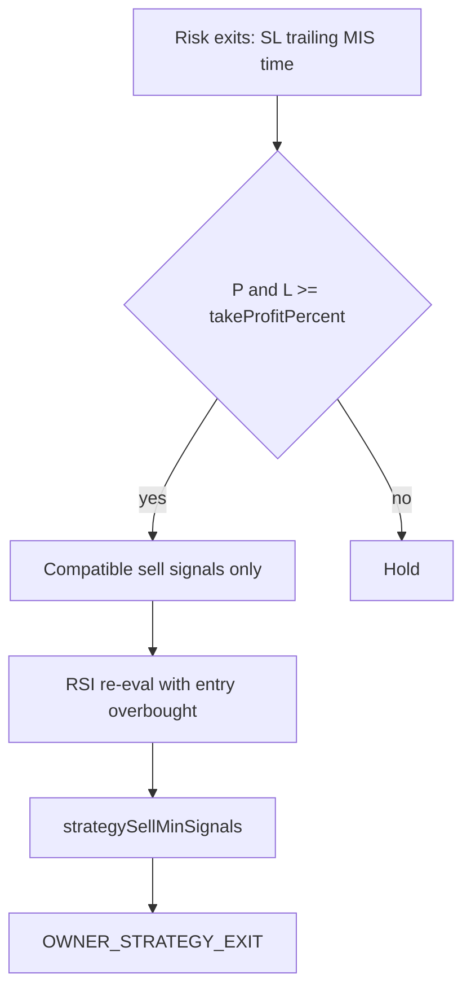

# AlgoTrader — Product Plan

**Single source of truth** for what is built, what is in progress, and what is left.  
Operational how-to: [PAPER-RUNBOOK.md](./PAPER-RUNBOOK.md).  
Last updated: 2026-05-27 · Shipped commit `47a30a4`.

---

## Summary

| Phase | Focus | Status |
|-------|--------|--------|
| **1** | Stabilize paper auto-trading | Mostly done |
| **2** | Smarter entries & exits (paper) | **Done** (incl. regime + entry-connected sells) |
| **3** | Live auto-trading | Not started |
| **4** | Analytics & optimization | Done |
| **5** | Product & ops polish | Partial |
| **5b** | Dashboard market intelligence | **Done** |

**Do not enable live auto-trading** until Phase 1 is stable for 4+ weeks and Phase 3 prerequisites are met.

---

## Phase 1 — Stabilize & trust paper auto-trading

| Item | Status | Notes |
|------|--------|-------|
| Paper trading health dashboard | Done | Dashboard → Paper trading health |
| Cron / scan health email alerts | Done | Failures, stale cron, zero trades, price corrections |
| Price correction tracking | Done | Scan diagnostics |
| Portfolio reconciliation | Done | Reconcile button + API |
| Paper runbook | Done | [PAPER-RUNBOOK.md](./PAPER-RUNBOOK.md) |
| Per-strategy paper P&L on Dashboard | Done | Compare with Strategies backtest |
| Zerodha quotes preferred in cron | **Left** | Yahoo still used for automated scans |

---

## Phase 2 — Smarter entries & exits (paper only)

| Item | Status | Notes |
|------|--------|-------|
| Universe scanning (12 strategy types) | Done | Top 100, Nifty 50, or custom — user config |
| Regime-weighted buy ranking (index ADX) | Done | `^NSEI` ADX(14) + slope; see below |
| Entry-connected strategy sells | Done | Compatible sells only; momentum RSI @ 85 |
| Volatility-based sizing | Done | Fixed ₹ / % balance / ATR-risk |
| Paper min/max per trade | Done | Default ₹25k–₹5L |
| Trailing stop from peak | Done | Settings → Risk |
| Time-based exits | Done | Max hold, MIS square-off, no-progress |
| Strategy performance + auto-pause | Done | Settings → Risk |
| Strategy SELL signals (2+ consensus) | Done | After min-hold + **5% profit gate** (floor, not cap) |
| Sortable tables (orders, audit, etc.) | Done | Click column headers |
| Remove Reset Portfolio from Paper tab | Done | Settings → Reset Paper Portfolio only |

### Phase 2 — left / future (not built)

| Item | Priority | Notes |
|------|----------|-------|
| Regime badge in Strategies “Last scan” UI | Low | Regime logged to system logs today |
| Literal parent-child native exits (Chandelier, candle time stops, per-parent targets) | Low | Matrix was design reference only |
| RSI neutral cross (50/60) for reversion exits | Low | Still uses standard RSI / BB scan sells |
| Per-stock ADX regime | Low | Index-only for v1 |
| Regime weighting on live Zerodha path | Blocked | Requires Phase 3 |

---

## Regime & entry-connected exits (shipped detail)

Commit **`47a30a4`** — May 2026.

### What it does

1. **Buy weighting** — Each cron scan fetches Nifty 50 index (`^NSEI`) daily bars, computes Wilder ADX(14) and 5-day ADX slope.
   - **ADX > 23 (TRENDING):** Trend 70% · Momentum 20% · Reversion 10%
   - **ADX ≤ 23 (MEAN REVERSION):** Trend 20% · Momentum 10% · Reversion 70%
   - Weights multiply strategy confidence in buy ranking (signal count unchanged).
   - **Independent of stock universe** — Top 100 vs Nifty 50 only affects which symbols are scanned.

2. **Entry-connected sells** — Positions store `ownerStrategyType` and `ownerEntryArchetype` at buy.
   - Only **compatible** sell strategies count toward `strategySellMinSignals` consensus.
   - **Momentum/breakout** entries: RSI sell uses overbought **85** (not 70) so RSI > 70 at entry does not false-exit.

3. **Unchanged safeguards**
   - Global **stop loss** always runs first.
   - Strategy sells only after P&L ≥ `takeProfitPercent` (default **5%**) — minimum to allow exits, not a maximum; can hold for 10%+ if sells don’t fire.
   - Trailing stop, MIS square-off, max hold days unchanged.

### Entry archetypes

| Archetype | Buy strategy types | Compatible sell families |
|-----------|-------------------|-------------------------|
| **MOMENTUM_BREAKOUT** | `breakout`, `ema` | Momentum + trend + RSI (≥85) |
| **TREND_FOLLOWING** | `sma`, `macd`, `supertrend`, `adx`, `golden_cross` | Trend + momentum (no reversion RSI/BB) |
| **MEAN_REVERSION** | `rsi`, `bollinger`, `stochastic`, `vwap`, `mean_reversion` | Reversion only (RSI @ 70) |

### Key files

| Module | Path |
|--------|------|
| ADX | `src/lib/market-data/adx.ts` |
| Regime snapshot | `src/lib/strategies/regime.ts` |
| Entry/exit compatibility | `src/lib/strategies/entry-exit-compat.ts` |
| Buy/sell queue | `src/lib/portfolio/portfolio-manager.ts` |
| Cron wiring | `src/lib/strategies/run-server.ts` |
| Settings | Settings → **Market Regime & Exits** |

## Settings architecture (paper vs live)

Settings page uses **three tabs** — always check the active tab before saving:

| Tab | Color | What it controls |
|-----|-------|------------------|
| **Paper Trading** | Blue | Simulated balance, sizing, regime, risk, strategy sells — **15-min cron only** |
| **Live Trading** | Amber | Zerodha accounts, max order ₹, daily loss cap, **live automation** (Phase 3) |
| **General** | Neutral | Email notifications |

- **`resolveAutomationSettings(settings, 'paper' | 'live')`** — [`src/lib/settings/automation-settings.ts`](../src/lib/settings/automation-settings.ts)
- Live defaults to **mirror paper automation** (`liveMirrorPaperAutomation: true`) until Phase 3 live cron ships
- When mirror is off, live-specific overrides (`liveStopLossPercent`, `liveEnableRegimeWeighting`, etc.) apply

### Shipped in settings UI (commit after `47a30a4`)

- Tabbed Paper / Live / General layout with mode banners
- Live auto-trading section with mirror toggle + override fields
- Paper sections labeled “Paper Auto-Scan — …”

### Exit flow



---

## Phase 3 — Live trading automation

| Item | Status |
|------|--------|
| Server-side Zerodha tokens (encrypted) | Not started |
| Live execution path (mirror `run-server.ts`) | Not started |
| Hard failsafes (`ENABLE_LIVE_TRADING`, daily loss cap) | Not started |
| Paper → live promotion workflow | Not started |
| Order lifecycle (slippage, partial fills, retries) | Not started |
| Pre-market checks (token, margin, market open) | Not started |

**Gate:** 4–8 weeks stable paper + promotion checklist in runbook.

---

## Phase 4 — Analytics & optimization

| Item | Status |
|------|--------|
| Portfolio analytics (Sharpe, drawdown, profit factor) | Done |
| Walk-forward / out-of-sample backtest | Done |
| Parameter grid search | Done |
| Trade journal + CSV export | Done |
| Benchmark vs Nifty 50 | Done |

---

## Phase 5 — Product & ops polish

| Item | Status |
|------|--------|
| Mobile-friendly UI | Done |
| Audit & compliance (trade log, daily P&L email, MIS square-off) | Done |
| Telegram bot | Not started |
| Multi-account (family / separate portfolios) | Not started |
| PostgreSQL candle cache | Not started |
| Dashboard market intelligence | **Done** → [Phase 5b](#phase-5b--dashboard-market-intelligence-planned) |

---

## Phase 5b — Dashboard market intelligence (planned)

**Goal:** Turn the Dashboard from a mixed portfolio/ops screen into a **market context** view — what the index and sectors are doing, and which stocks are driving moves. Paper P&amp;L detail stays on **Paper Trading**; ops health moves to a **compact strip** (full panel remains on Paper Trading).

**Status:** Done — May 2026.

### Remove from Dashboard

| Widget | Rationale |
|--------|-----------|
| **Watchlist** | Not core to market overview; feature can move to nav or Paper Trading later |
| **Recent Trades** | Full history on Paper Trading tab |
| **Unrealized P&amp;L** card | Duplicated on Paper Trading |
| **Today's P&amp;L** card | Duplicated on Paper Trading |
| **NSE Status** card | Client-side only; no live NSE feed — replace with subtle market-hours indicator in header |

### Keep on Dashboard (unless changed later)

| Widget | Rationale |
|--------|-----------|
| **Portfolio Value** (+ all-time realized %) | One-line “how am I doing” without opening Paper Trading |
| **Realized P&amp;L** | Complements portfolio value; less noisy than unrealized/today |
| **Portfolio Performance** chart | Personal benchmark vs market context below |
| **Paper health** | **Slim strip only** — last cron, drift badge, link to Paper Trading / Reconcile (remove full `PaperHealthPanel` duplicate) |

### Add — layout (top → bottom)

```
┌─────────────────────────────────────────────────────────────┐
│  Header: "Dashboard" + date + market open/closed pill         │
├─────────────────────────────────────────────────────────────┤
│  Row 1: Portfolio Value │ Realized P&L │ (optional 3rd KPI) │
├─────────────────────────────────────────────────────────────┤
│  MARKET TREND (hero)                                        │
│  · Nifty 50 (^NSEI) day % + sparkline                       │
│  · Regime badge: TRENDING / MEAN REVERSION (reuse ADX logic)│
│  · ADX value + slope arrow · Bank Nifty / India VIX (opt.)  │
├─────────────────────────────────────────────────────────────┤
│  SECTOR PERFORMANCE — horizontal bar chart, best → worst    │
│  · Sorted by % change (default: today)                      │
│  · Color: green → red gradient                              │
│  · Toggle: 1D │ 5D │ 1M (v1 can ship 1D only)                 │
├─────────────────────────────────────────────────────────────┤
│  SECTOR DRILL-DOWN (click or expand row)                    │
│  · Top 3–5 **drivers** per sector: symbol, % chg, volume    │
│  · Bottom 3 **draggers** (optional v1.1)                    │
├─────────────────────────────────────────────────────────────┤
│  Portfolio Performance chart (existing)                     │
├─────────────────────────────────────────────────────────────┤
│  Paper health compact strip                                 │
└─────────────────────────────────────────────────────────────┘
```

### Market trend — definition

Reuse existing regime engine ([`regime.ts`](../src/lib/strategies/regime.ts)):

| Signal | Source | Display |
|--------|--------|---------|
| Index level &amp; day % change | Yahoo `^NSEI` via `/api/market/quote` | Large number + sparkline (intraday or 5D) |
| **Regime** | ADX(14) vs threshold (default 23) + slope | Badge: **Trending** vs **Mean reversion** |
| Regime weights | Already computed | Small donut or 3-bar: Trend / Momentum / Reversion % |
| Index history | `/api/market/history` | Area chart behind hero |

**Optional v1.1:** Bank Nifty (`^NSEBANK`), India VIX (`^INDIAVIX`) as secondary tiles.

### Sector performance — definition

| Decision | Recommendation |
|----------|----------------|
| **Sector list** | Nifty sectoral indices (official NSE buckets) — not ad-hoc industry strings |
| **Metric** | Index `% change` for selected timeframe (default: session/day) |
| **Sort** | Descending by % change (best sector at top) |
| **Universe for stock drivers** | **Top 100 symbols** (matches scan universe) — not full NSE |

**Sector index map (Yahoo symbols — verify at build time):**

| Sector | Yahoo ticker (candidate) |
|--------|--------------------------|
| Bank | `^NSEBANK` |
| IT | `^CNXIT` |
| Auto | `^CNXAUTO` |
| FMCG | `^CNXFMCG` |
| Pharma | `^CNXPHARMA` |
| Metal | `^CNXMETAL` |
| Energy / Oil &amp; Gas | `^CNXENERGY` |
| Realty | `^CNXREALTY` |
| Financial Services (ex-bank) | `^CNXFIN` |
| Media | `^CNXMEDIA` |
| PSU Bank | `^CNXPSUBANK` |
| Private Bank | (subset or `^NSEBANK` overlap — clarify at build) |

New file: `src/lib/universe/sector-map.ts` — `symbol → sectorId` for Top 100 / Nifty 50 constituents (manual JSON from NSE constituent sheets; refresh quarterly).

### “Stocks strongly affecting trends” — definition

**v1 rule (simple, explainable):**

Within each sector, rank Top 100 stocks mapped to that sector by:

1. **Absolute day % change** (primary sort)
2. Tie-break: **relative volume** vs 20-day average (if history available) or raw day volume from Yahoo

Show **top 3 drivers** (biggest positive movers) and **top 3 draggers** (biggest negative) per sector when user expands a sector row.

**Not in v1:** formal index contribution / beta-weighted attribution (heavier math; defer to v2).

### Data layer (new)

| Piece | Path / route |
|-------|----------------|
| Sector constants | `src/lib/universe/sectors.ts` |
| Symbol → sector | `src/lib/universe/sector-map.ts` |
| Server aggregator | `src/lib/market-data/sector-performance.ts` |
| API | `GET /api/market/sectors?timeframe=1d` |
| Regime for dashboard | `GET /api/market/regime` (or fold into sectors response) |
| Client component | `src/components/dashboard/market-trend-hero.tsx` |
| Client component | `src/components/dashboard/sector-performance-chart.tsx` |
| Client component | `src/components/dashboard/sector-drivers-panel.tsx` |

**Caching:** In-memory or Firestore doc refreshed every **5 min** when market open, **30 min** when closed — avoid N× Yahoo calls per page load.

**Disclaimer in UI:** “Prices delayed ~15 min (Yahoo)” — same as watchlist today.

### Charts (Recharts — already in project)

| Chart | Type |
|-------|------|
| Sector ranking | Horizontal bar chart (% on X, sector name on Y) |
| Market trend | Area/sparkline for Nifty + optional multi-index small multiples |
| Regime weights | Stacked bar or pie (small) |
| Sector expand | Mini table with green/red % badges — no chart required |

### Gaps / decisions to confirm before build

| Topic | Question | Default if no answer |
|-------|----------|----------------------|
| **Watchlist fate** | Delete feature or move to own page / Paper Trading? | Hide from Dashboard; keep Firestore + add “Watchlist” nav link later |
| **Timeframes** | 1D only or 1D + 5D + 1M toggle? | Ship **1D**; add toggle in v1.1 |
| **Third KPI card** | Replace removed cards with Market Regime summary card? | Yes — regime + Nifty % in card row |
| **Paper health** | Strip vs remove entirely from Dashboard? | **Compact strip** (cron age, drift count) |
| **Bank Nifty / VIX** | Include in hero? | Optional v1.1 |
| **Custom universe** | Show sectors for user’s custom symbol list? | No — always **Top 100 sector map** for v1 |
| **Live trading** | Dashboard is display-only | No order impact; same for paper and live users |

### Build tasks (ordered)

1. `sectors.ts` + `sector-map.ts` + unit tests for mapping coverage (Nifty 50 ≥ 95% mapped)
2. `sector-performance.ts` aggregator + `/api/market/sectors`
3. `/api/market/regime` (or combined payload) exposing snapshot for UI
4. `MarketTrendHero` component
5. `SectorPerformanceChart` + expandable drivers panel
6. Refactor `dashboard/page.tsx` — remove widgets, wire new sections, slim health strip
7. Update [PAPER-RUNBOOK.md](./PAPER-RUNBOOK.md) — health checklist points to Paper Trading for full panel
8. Manual QA: market open vs closed, empty sectors, Yahoo symbol failures

### Out of scope (v1)

- Intraday sector heatmap animation
- Portfolio sector exposure overlay (“your holdings by sector”)
- NSE official API / bhavcopy parser
- Per-stock ADX regime on dashboard (index-only matches Phase 2)

---

## Suggested next work (ordered)

1. **Run paper 4+ weeks** with regime + entry-connected exits enabled; review scan logs and audit trail.
2. **Regime in Last scan UI** — show TRENDING/MEAN_REVERSION badge on Strategies page (data already in system logs).
3. **Watchlist page** (optional) — Firestore watchlist data preserved; add nav link if needed.
4. **Zerodha quotes in cron** (Phase 1 leftover) — reduce Yahoo delay on execution prices.
5. **Phase 3** — only after promotion checklist passes.

---

## Related docs

- [PAPER-RUNBOOK.md](./PAPER-RUNBOOK.md) — daily ops, checklist, troubleshooting
- [SERVER-STRATEGY-CRON.md](./SERVER-STRATEGY-CRON.md) — cron setup (if present)
